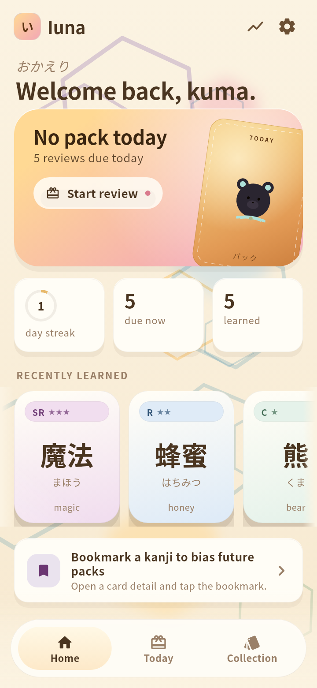
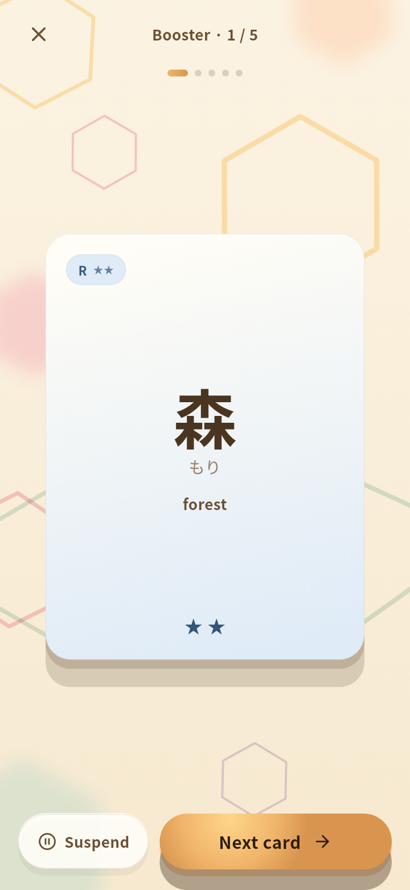
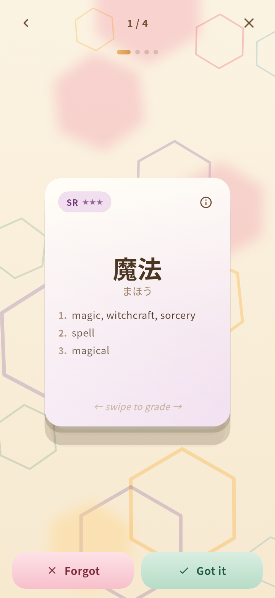
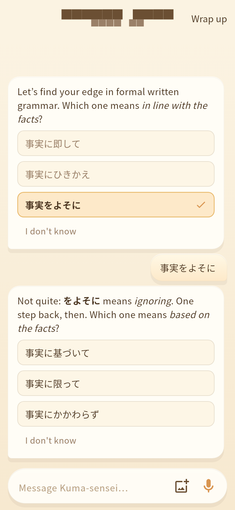

# Iuna

A bear-themed, gacha-style Japanese vocabulary app for Android. Open
daily booster packs, collect cards by rarity, and keep them with spaced
repetition. An optional AI tutor runs courses with you.

<p>
  
  
  
  
</p>

## Features

- **Daily boosters.** Each pack holds ten new words, drawn from a
  26,000-word deck built from JMdict. Rarity, from Common up to UR,
  reflects how frequent a word is; the JLPT level is shown separately.
- **Reviews.** Tap to flip a card, then swipe or use the buttons to say
  whether you knew it. Scheduling is a two-button SM-2. You get undo, a
  details sheet, and a recap at the end.
- **Collection.** Search, filter by rarity, show the cards you're
  missing, open any card's senses and examples, and hear it read aloud.
- **Wishlist.** Bookmark a word you met elsewhere and it will turn up in
  a booster soon.
- **Card packs and dictionary.** Optional themed packs (for example
  Science & Programming) and a full JMdict dictionary, downloaded on
  demand, so you can add any word to your deck.
- **Stats.** Activity, retention, streaks, maturity, forecast, leeches.
- **Backup.** To your own Google Drive, or as a local file.
- **AI tutor (optional).** Kuma-sensei probes your level, plans a
  course, teaches chapter by chapter, quizzes you, and can bookmark
  vocabulary into your deck. You can type, dictate, or send photos.

## Build from source

You need Flutter 3.41.x (Dart 3.11) and an Android device or emulator.

```bash
flutter pub get
dart run build_runner build --delete-conflicting-outputs
flutter run
```

Tests: `flutter test --exclude-tags golden`. The golden screenshots also
need the Noto CJK and Color Emoji fonts linked by
`tools/setup_test_fonts.sh`. The Linux desktop build works for quick
checks; on GNOME/Wayland start it with `GDK_BACKEND=x11`.
[docs/ARCHITECTURE.md](docs/ARCHITECTURE.md) explains how it fits
together.

Release builds sign with `android/key.properties` (see
`android/key.properties.example`) and otherwise fall back to the debug
key. Google sign-in for Drive backup only works for package/SHA-1 pairs
registered in a Google Cloud project, so a fork that wants it needs its
own `applicationId`, an Android OAuth client for that package and each
signing key's SHA-1, and the `drive.appdata` scope on the consent
screen.

This is a personal project and doesn't take pull requests, but you're
welcome to fork it under the licence below.

## The AI tutor

The Learn tab appears once you save an [OpenRouter](https://openrouter.ai)
API key under Settings → AI tutor (create one at
[openrouter.ai/keys](https://openrouter.ai/keys)).

- You pay OpenRouter directly for what you use. Settings → AI tutor
  shows what the tutor has cost so far.
- The default model is `deepseek/deepseek-v4-flash-0731`, and you can
  pick any OpenRouter model id.
- Dictation is transcribed with MAI-Transcribe 2 through the same key.

The tutor can be wrong. Treat it like a helpful study partner, not an
authority.

## Privacy

Iuna has no server and no analytics. Your deck, progress and courses
stay on your device.

- **Drive backup** is opt-in. It goes to a hidden per-app folder in your
  own Google Drive (`appDataFolder`), using only the `drive.appdata`
  permission, which can't see your other files.
- **The AI tutor** sends what you write, photos you attach and your
  dictation audio to OpenRouter, and through it to the model provider,
  under your own key. Don't send anything you wouldn't share with them.
  Audio is used only for transcription and is never stored.
- **Downloads.** Card packs and the dictionary are fetched from GitHub
  (`raw.githubusercontent.com`).

## Data sources and licence

The code is under the [MIT License](LICENSE).

The vocabulary data is derived from **JMdict** (EDRDG), **Tatoeba**
example sentences, Jonathan Waller's **JLPT lists**, and the **Leeds
internet-jp frequency list**. The bundled deck and the downloadable data
are therefore under **CC-BY-SA 4.0**. Full credits are in
[NOTICE](NOTICE) and in the app under Settings → Data sources.
